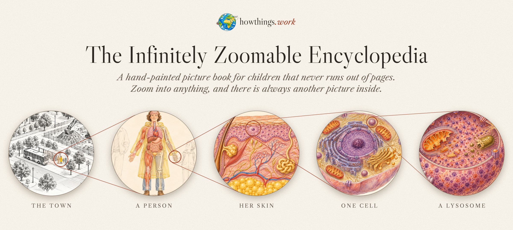
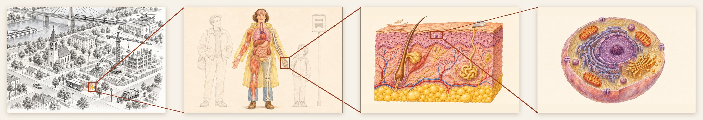
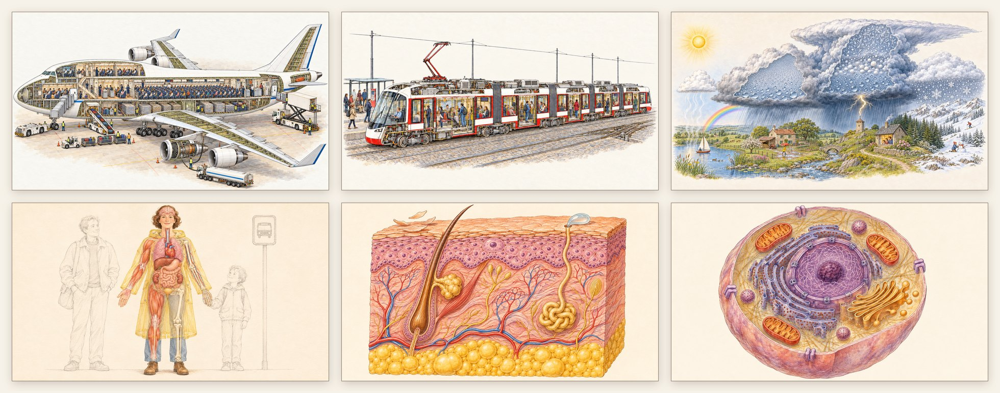
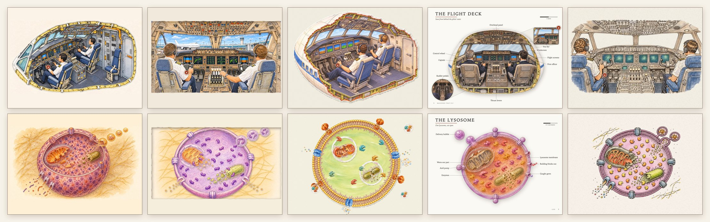

<p align="center"><a href="https://howthings.work"></a></p>

<p align="center">
  <a href="https://howthings.work"><b>Open it → howthings.work</b></a> &nbsp;·&nbsp;
  <a href="#build-the-next-page-get-your-name-on-it">Add a page</a> &nbsp;·&nbsp;
  <a href="lab/">The lab</a> &nbsp;·&nbsp;
  <a href="#licence">Licence</a>
</p>

# The Infinitely Zoomable Encyclopedia

**howthings.work is a hand-painted picture book for children that never runs out of pages.** It opens on a
pencil map of a little river town. Everything in colour opens up. Tap the jumbo jet and the town turns into a
cut-away of the plane. Tap its engine and you're looking at the fan blades. Tap the woman at the bus stop and
you're inside her body, then her skin, then a single cell. There is always another picture inside.

It's free, it runs in any browser, and it's open source. Anyone can add the next page with their AI agent.

<p align="center"></p>

## One picture inside another

Every picture sits inside the one above it. The camera flies down until the little drawing lands exactly where the
bigger painting will be, and the bigger painting takes over while you are still moving. It feels like zooming into
one endless picture.




There is no bottom: a cell has a nucleus, the nucleus has DNA, and each is just one more picture inside the last.
The same rules are ready to go upwards too, from the town to the country, the Earth and the solar system
([how the tree of spaces works](docs/SPACES.md)).

## What's in the book today



| | Look inside | Moving "How it works" pages |
|---|---|---|
| **The Jumbo Jet** | 52 parts, from the flight deck to the ovens in the galley; three levels of deep zoom | fly it from the cockpit, spool up an engine, run the belt loader and the scissor lift, heat the oven |
| **The City Tram** | 23 parts, the pantograph down to its carbon strip | where its power comes from, how the points steer it |
| **The Weather** | 12 parts: how a cloud is born, why it rains, how hot lightning is, why snowflakes have six arms | grow raindrops in a cloud; count from the flash to the thunder |
| **The Human Body → Skin → The Cell** | a person at the bus stop, down through her skin to the parts inside one cell | |

Everything grey on the map (the excavator, the tower crane, the church bell, the fire engine…) is waiting for
someone to build it.

**How it's made:**
- **Pictures:** ink and watercolour on ivory paper, like the cut-away books of the 1980s and 90s. No text inside a
  picture; every label is drawn by code.
- **Counts and mechanics are checked:** a 747 has 18 wheels, and snowflakes have six arms.
- **Motion is code, never video:** the lever really moves the thrust, and the raindrops really grow.
- **Smooth:** pictures are decoded before you reach them and sharper ones fade in with the zoom, so it holds
  120 frames a second in our tests.

## Build the next page, get your name on it

You don't need to draw or code. Pick something grey on the map, give your AI agent this prompt, and spend your
tokens on something children will love:

> Go to https://howthings.work/contribute.md and follow it. Help me pick a machine that isn't in colour on
> the map yet and isn't already in an open pull request, then build it in the howthings.work style and open
> a pull request with screenshots. Credit it to: *your name or @handle, and a link*.

Your agent paints the pictures, writes the pages, tests everything and opens a pull request with screenshots.
Once it's merged, your machine turns colour on the map with your name on it.

**For agents working in this repository:** read [AGENTS.md](AGENTS.md) first, then use the skills it names
(`infinite-book-explainer` from [virpo/agent-skills](https://github.com/virpo/agent-skills), and
`.claude/skills/add-a-machine` here). The full walkthrough is [docs/ADD-A-MACHINE.md](docs/ADD-A-MACHINE.md).

## The lab: five ways to paint an infinite book



One big painting per space looks wonderful, but takes about an hour and is hard to change later. So the same
demo was built five ways:
- **patchwork painting:** today's method, plus a tool that repaints one object in place
- **paper theatre:** cut-paper layers with parallax
- **sticker kit:** a library of objects placed by code
- **encyclopedia page:** white pages of cut-outs with drawn labels
- **ink and wash:** vector pen lines that stay sharp at any zoom, over a watercolour wash

The demo goes town → jumbo jet → flight deck → you fly it, and town → person → skin → cell → lysosome, with every
text written for ages 3, 5, 7, 9 and 11.

The pick, ink and wash, made each space in about 6 generation minutes instead of an hour, and every dive lands.
The sticker kit added two people to the bus stop with no new pictures at all. The numbers, the edit tests and the
side-by-side comparison are in [lab/](lab/).

## Running it

```
pip install pillow numpy scipy scikit-image
python3 build.py                        # paintings → dist/ (a few minutes the first time)
python3 -m http.server -d dist 8765     # then open http://localhost:8765
python3 -m http.server -d lab 8766      # the lab's comparison: http://localhost:8766
```

Checks: `node tools/smoke.mjs` (every machine, part and page) and `node tools/perf.mjs` (frame times and
sharpness through every zoom). More in [docs/DEVELOPING.md](docs/DEVELOPING.md).

## Licence

Open to read, run and build on. Code: MIT. Pictures and texts: [CC BY-NC 4.0](https://creativecommons.org/licenses/by-nc/4.0/):
free for homes, classrooms and non-commercial projects, with credit to howthings.work. For commercial
use (courses, apps, books, products), ask [@virpo](https://x.com/virpo). Contributions are welcome under the
[Contributor Terms](CONTRIBUTING.md). Details in [LICENSE](LICENSE). Made by [@virpo](https://x.com/virpo), developed with love™.
