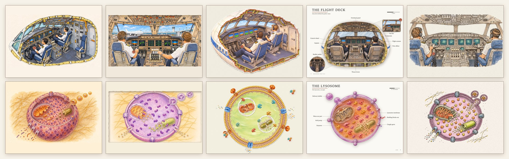

# The lab: five ways to paint an infinite book



*The flight deck (top) and a lysosome (bottom). Left to right: patchwork painting, paper theatre, sticker kit,
encyclopedia page, ink and wash.*

The live site paints every space as one big picture. It looks like a book, but each one takes about an hour of
generating and checking (the weather took 47 minutes, the body 65). Changing one thing later, like five people at
the bus stop instead of three, means repainting a patch by hand. This lab built **the same demo five ways** to
find a better method: more beautiful, easier to make every part, easier to change, and nicer to use.

**The demo is the same in every variant**: one town and two dives, eight spaces and 51 parts. The words are
written for ages 3, 5, 7, 9 and 11, with an age switch in the header, and the viewer is the same in all five.

```
town ─┬─ jumbo jet ── flight deck ── you fly it
      └─ a person at the bus stop ── her skin ── one cell ── a lysosome
```

## Results

| | Image calls | Gen. minutes | Download | Edit: five people | Edit: coffee cup | Best at | Weakest at |
|---|---:|---:|---:|---|---|---|---|
| **[Patchwork painting](v1-patchwork/)**: one painting per space plus an in-place region repaint tool | 9 + 5 reused | 12 + reused | 7.9 MB | 1 call · 5 min | 2 calls · 4 min | the richest paintings | cost to grow; soft below the town and jet |
| **[Paper theatre](v2-paper-theatre/)**: 4–7 cut-paper layers per space, with parallax | 43 | 50 | 6.3 MB | 1 call · 2 min | 1 call · 3 min | the most beautiful scenes; one-layer edits | soft when you zoom in |
| **[Sticker kit](v3-sticker-kit/)**: an isometric library of objects, scenes built from JSON | 21 | 26 | 5.9 MB | **0 calls** · 78 s | 1 call · 3 min | editing, reuse, growth | looks assembled, like a game |
| **[Encyclopedia page](v4-encyclopedia-page/)**: white pages of cut-out subjects and drawn labels | 17 | 23 | 5.2 MB | 1 call · 3 min | 1 call · 2 min | cheapest and cleanest | the town stops being a place |
| **[Ink and wash](v5-ink-and-wash/)**: vector pen lines over a separate watercolour wash | 30 | 53 | **3.9 MB** | 2 calls · 8 min | 2 calls · 11½ min | sharp at any zoom; every dive lands | heavier ink in places |

Image calls and minutes come from each variant's `genlog.jsonl`. The download is everything a visitor loads walking
both chains. Patchwork reused five of the live site's spaces, so its numbers count only the three new ones.

## The recommendation

**Ink and wash, with two ideas borrowed from the others.**
- It has one coherent book look. Its lines are vectors, so they stay sharp at any zoom, and adding a finer level
  is cheap because it is lines only.
- Every child is drawn inside its parent from the child's own drawing, so all seven dives land within a few pixels.
- It costs about 6 generation minutes per space, against 47–65 with today's method, and it was the smallest
  download.

From the **paper theatre**, take layers: paint each scene whole, then separate it into layers with edits. An edit
then redoes one layer, and the layers give the parallax that makes it feel like a real book. From the **sticker
kit**, take a library of the things that come and go (people, props, vehicles) placed by code. Five people at the
bus stop took no image calls at all there.

## What every builder found

- **Paint the child inside the parent, from the child's own picture.** Two pictures painted separately never line
  up well enough for a dive.
- **Never paint things that must line up as separate pictures.** Paint the whole thing, then separate it with edits
  (the paper theatre's separate layers drifted; its extracted ones were within 1 px).
- **Outlines traced from cut-outs are free; hand-traced outlines are the slowest step.**
- **Line art is what image models get right first time.** All seven ink drawings had the right counts on the
  first try: 4 engines, 18 wheels, two pilots side by side, the skin's layers.

## Look for yourself

```
python3 -m http.server 8766 -d lab      # from the repository root
open http://localhost:8766/             # the comparison: one space in all five, any age, the numbers, the edit tests
```

Each variant folder has `APPROACH.md` (its brief), `REPORT.md` (the builder's own numbers, edit test and scores),
its prompts in `art/prompts/` and its tools in `tools/`.

Shared pieces:
- `content.js`: all the words, by age.
- `core/`: the viewer every variant plugs into (`core/API.md`).
- `tools/gen.sh`: every image call, logged per variant.
- `tools/shots.mjs`: walks both chains like a child and saves screenshots.
- `tools/weigh.mjs`: download weight.
- `tools/compare.py`: builds the comparison page.

Only the files each demo loads are tracked (listed in `v*/SHIPPED.txt`). Generated sources, rejected images and
most screenshots stay local.
